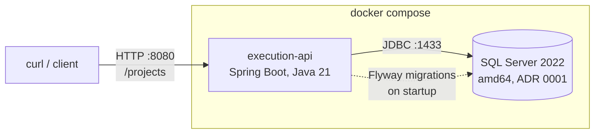

# container-playground

Spring Boot API (`execution-api`) on SQL Server, packaged with Docker and run with Compose.

## Architecture



## Quick start

Needs Docker. On Apple Silicon, SQL Server runs under emulation (slow first start).

```sh
cp .env.example .env               # then change the password
docker compose up --build -d --wait  # build, start, and block until healthchecks pass
curl localhost:8080/projects         # []
```

Run the tests (they start their own SQL Server via Testcontainers):

```sh
./mvnw verify
```

## Decisions

- [ADR 0001: SQL Server as amd64 under emulation](docs/adr/0001-sql-server-amd64-emulation.md)
